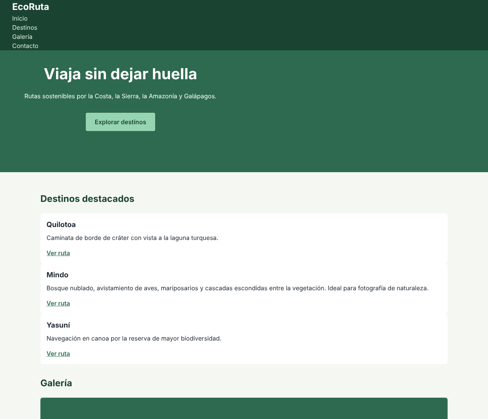
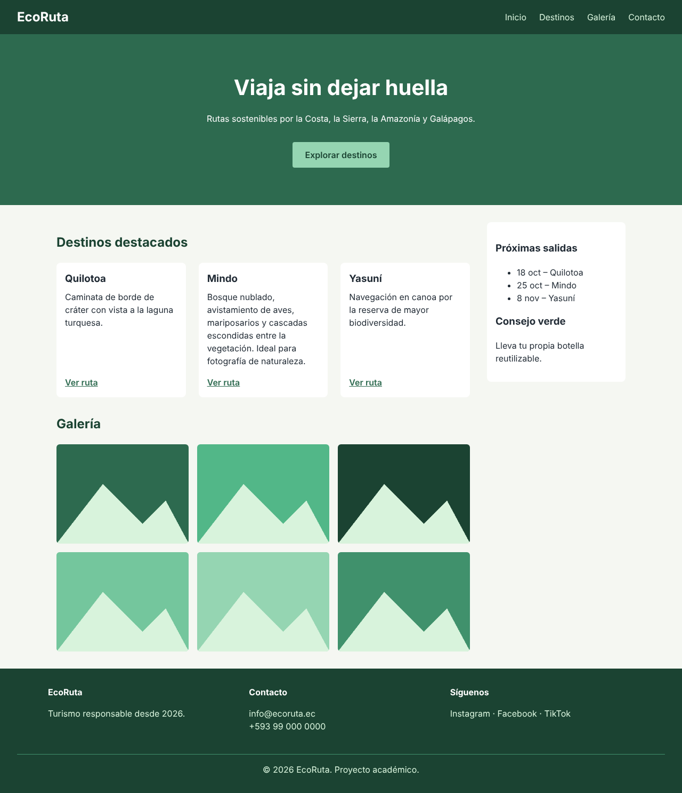
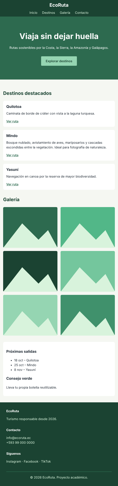

# 🌿 EcoRuta — Un diseño, dos caminos

EcoRuta es un sitio de turismo sostenible en Ecuador. En este repositorio está la página **sin ninguna regla de distribución**: tiene colores, tipografía y espaciado.

Tu reto es construir **dos versiones** de la misma página **sin modificar el HTML ni `base.css`**:

| Versión | Archivo HTML | Hoja que debes escribir | Técnica permitida |
|---|---|---|---|
| A | `flexbox.html` | `css/flexbox.css` | Solo **Flexbox** |
| B | `grid.html` | `css/grid.css` | Solo **Grid** |

**Meta:** ambas versiones deben verse **exactamente iguales** al diseño objetivo, tanto en escritorio como en móvil.

---

## 🎯 Diseño objetivo

| Punto de partida (`index.html`) | Objetivo en escritorio (1280 px) | Objetivo en móvil (600 px) |
|:---:|:---:|:---:|
|  |  |  |

**Especificaciones del diseño:**

- **Cabecera:** el logo a la izquierda y el menú a la derecha, ambos centrados verticalmente. Separación entre enlaces: `1.5rem`.
- **Hero:** el contenido centrado vertical y horizontalmente dentro de su bloque, de 320 px de alto mínimo.
- **Estructura:** el contenido principal ocupa el espacio restante y la barra lateral mide **260 px fijos**. Separación: `2rem`. La barra lateral **no** se estira hasta la altura del contenido.
- **Tarjetas:** tres tarjetas de igual ancho e **igual altura**, separadas por `1.5rem`, con el enlace "Ver ruta" alineado al fondo de cada una.
- **Galería:** seis imágenes en **3 columnas × 2 filas**, separadas por `1rem`.
- **Pie de página:** tres columnas de igual ancho, separadas por `2rem`.
- **Pantallas de 768 px o menos:**
  - Cabecera apilada y centrada.
  - Todo en una sola columna, con la barra lateral debajo del contenido.
  - Tarjetas y columnas del pie apiladas, separadas por `1rem`.
  - Galería en **2 columnas**.

---

## 📁 Estructura del repositorio

```text
ecoruta/
├── index.html          ← página original (solo base.css) — NO MODIFICAR
├── flexbox.html        ← base.css + flexbox.css         — NO MODIFICAR
├── grid.html           ← base.css + grid.css            — NO MODIFICAR
├── css/
│   ├── base.css        ← colores, tipografía, espaciado — NO MODIFICAR
│   ├── flexbox.css     ← ✏️ tu versión con Flexbox
│   └── grid.css        ← ✏️ tu versión con Grid
└── docs/img/           ← capturas del diseño objetivo
```

> ⚠️ **Regla de oro:** solo se editan `css/flexbox.css` y `css/grid.css`. Si tu solución necesita cambiar el HTML o `base.css`, vuelve a pensar el enfoque.

---

## 🚀 Cómo empezar

1. **Haz un *fork*** de este repositorio en tu cuenta de GitHub y **clónalo**:

   ```bash
   git clone https://github.com/<tu-usuario>/ecoruta.git
   cd ecoruta
   ```

2. **Crea una rama** de trabajo:

   ```bash
   git switch -c practica/flexbox-grid
   ```

3. **Abre el proyecto** en VS Code y ejecútalo con la extensión **Live Server**: clic derecho sobre `flexbox.html` → *Open with Live Server*. También puedes abrir los archivos HTML directamente en el navegador.

4. Coloca `flexbox.html` y `grid.html` en **dos ventanas lado a lado**: las compararás durante toda la práctica.

> 💡 Las imágenes se cargan desde `picsum.photos`. Sin conexión a Internet, cada imagen se muestra como un bloque verde claro y el ejercicio funciona igual.

---

## 🔍 Cómo verificar tu trabajo

1. Abre DevTools (`F12`) y activa las insignias **`flex`** y **`grid`** en el panel *Elements* para ver los contenedores.
2. Usa el modo dispositivo (`Ctrl + Shift + M`) y compara ambas versiones a **1280 px**, **600 px** y **360 px**.
3. Compara tus versiones con las capturas de `docs/img/`.
4. Revisa que **no** hayas usado técnicas ajenas a la versión.

---

## 🧾 Entrega

1. Haz *commits* pequeños y descriptivos, **uno por actividad y versión**. Por ejemplo:

   ```bash
   git add css/flexbox.css
   git commit -m "feat(flexbox): cabecera y hero (actividad 1)"

   git add css/grid.css
   git commit -m "feat(grid): cabecera y hero (actividad 1)"
   ```

2. Sube tu rama y abre un **Pull Request** hacia `main` de **tu** *fork*:

   ```bash
   git push -u origin practica/flexbox-grid
   ```

3. En la descripción del Pull Request incluye:
   - Capturas de ambas versiones a 1280 px y 600 px.
---

## 📚 Recursos

- MDN — [Conceptos básicos de Flexbox](https://developer.mozilla.org/es/docs/Web/CSS/CSS_flexible_box_layout/Basic_concepts_of_flexbox)
- MDN — [Conceptos básicos de Grid Layout](https://developer.mozilla.org/es/docs/Web/CSS/CSS_grid_layout/Basic_concepts_of_grid_layout)
- web.dev — [Learn CSS: Flexbox](https://web.dev/learn/css/flexbox) · [Learn CSS: Grid](https://web.dev/learn/css/grid)
- CSS-Tricks — [A Complete Guide to Flexbox](https://css-tricks.com/snippets/css/a-guide-to-flexbox/) · [A Complete Guide to CSS Grid](https://css-tricks.com/snippets/css/complete-guide-grid/)
- Juegos — [Flexbox Froggy](https://flexboxfroggy.com/#es) · [Grid Garden](https://cssgridgarden.com/#es)
- [Can I use](https://caniuse.com/): compatibilidad entre navegadores

---

## 📄 Licencia y créditos

Proyecto con fines exclusivamente académicos. EcoRuta es una marca ficticia. Las imágenes de ejemplo provienen de [Lorem Picsum](https://picsum.photos/).